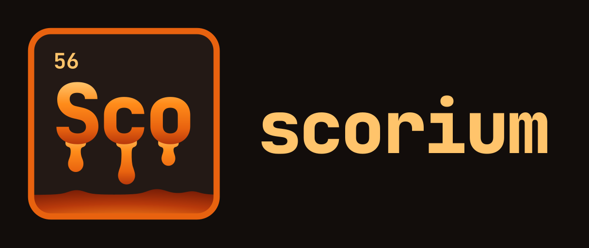

<p align="center">
  <picture>
    <source media="(prefers-color-scheme: light)" srcset="assets/brand/lockup-light.svg">
    
  </picture>
</p>

# Scorium language specification

[](https://github.com/Scorium-lang/scorium-spec/actions/workflows/ci.yml)
[](./VERSION)
[](./CHANGELOG.md)
[](./LICENSE)
[](https://github.com/Scorium-lang/scorium-spec/stargazers)
[](https://github.com/Scorium-lang/scorium-spec/issues)

**Readable on the surface. Programmable when you need it.**

This repository is the implementation-independent specification for the
Scorium configuration language. It defines the grammar, value semantics,
evaluation rules, canonical formatting, diagnostics, sandbox requirements,
and the shared conformance fixtures used by native implementations.

When an implementation disagrees with this specification, the disagreement
must be resolved explicitly. An implementation's source code does not
silently override the language contract.

```scor
@base_port = 8000

server {
    host = localhost
    port = base_port + 80
    timeout = 5s
    enabled = true
}

for i = 1, 3 do
    worker {
        name = worker-$i
        index = i
    }
end
```

## Status

The current language version is **`0.2.1`**. Sections 0–6 are stable and
normative for that version, with behavior verified independently by the Rust
and TypeScript/JavaScript implementations. Section 7 is an informative,
unapproved proposal and is not part of the language contract.

The repository contains **56 conformance fixtures** across values,
evaluation, diagnostics, formatting, sandbox, and schema behavior. Scorium remains
pre-1.0, so a future minor language version may make incompatible changes;
version `0.2.1` itself is no longer a draft.

## Specification

- [Roadmap](./ROADMAP.md)

- [Overview and design principle](./spec/00-overview.md)
- [Lexical structure and grammar](./spec/01-lexical-and-grammar.md)
- [Value semantics](./spec/02-value-semantics.md)
- [Evaluation rules](./spec/03-evaluation.md)
- [Canonical formatter behavior](./spec/04-formatter.md)
- [Diagnostic model](./spec/05-diagnostics.md)
- [Sandbox and security rules](./spec/06-sandbox-and-security.md)
- [Conformance-level proposal](./spec/07-conformance-levels.md)

## Conformance fixtures

Fixtures live under `conformance/v<language-version>/`. Each implementation
runs the directory matching the language version it claims to support. The
fixture format uses tagged semantic values so integers, floating-point edge
cases, repeated nodes, and formatter byte identity remain unambiguous across
host languages.

See [the conformance format](./conformance/README.md) before implementing a
harness or contributing a fixture. Compatibility comes from these fixtures,
not from implementations sharing source code or release schedules.

The versioned [`tooling` contract](./tooling/README.md) separately defines
portable command-line JSON and exit behavior.

## Implementations

Scorium belongs to no single host language. Every implementation is a peer:
it targets the same specification, proves compatibility with the shared
fixtures, and exposes APIs suited to its own ecosystem.

- [`scorium-rs`](https://github.com/Scorium-lang/scorium-rs) -- native Rust
  implementation, including the Lua execution surface.
- [`scorium-js`](https://github.com/Scorium-lang/scorium-js) -- native
  TypeScript/JavaScript implementation of the non-Lua language core.
- [`scorium-go`](https://github.com/Scorium-lang/scorium-go) -- native Go
  implementation of the non-Lua language core.
- [`scorium-jvm`](https://github.com/Scorium-lang/scorium-jvm) -- native JVM
  implementation (a Java core with a Kotlin-friendly API) of the non-Lua
  language core.

An implementation version and a language version are separate. For example,
an implementation may release version `0.9.0` while declaring support for
language version `0.2.1`.

## Repository layout

- `spec/` -- one specification document per language concern.
- `conformance/` -- fixture format and versioned fixture corpora.
- `tooling/` -- cross-port CLI and portable syntax-tree contract.
- `VERSION` -- current language version.
- `CHANGELOG.md` -- language-version history.

## Security

This repository defines diagnostic and sandbox *requirements* -- it has no
runtime of its own to secure. Report security-sensitive specification flaws
(an underspecified rule an implementation could read as safe when it isn't)
privately as described in [SECURITY.md](./SECURITY.md).

## Licensing

Logos and hero artwork by [Fi3w0](https://github.com/Fi3w0) are licensed
separately under [Creative Commons Attribution-NonCommercial-ShareAlike
4.0 International](./assets/brand/LICENSE) (CC BY-NC-SA 4.0). See the
[brand assets](./assets/brand/README.md) for variants and attribution.
This artwork license does not apply to implementation code or specification text.

Scorium is **source-available** under the
[PolyForm Strict License 1.0.0](./LICENSE). It is free for personal,
educational, hobby, and local noncommercial use, and for contribution-focused
forks. **Commercial use requires a written agreement.**

Scorium is *not* OSI-approved open source. Only official releases published
by @fi3w0 are sanctioned distribution channels; see
[COMMERCIAL.md](./COMMERCIAL.md) and [TRADEMARKS.md](./TRADEMARKS.md).

> The legal files are initial project terms that have not been reviewed by a
> lawyer. Obtain professional legal review before relying on them for
> commercial use.

## Contributing

Contributions are welcome. Read [CONTRIBUTING.md](./CONTRIBUTING.md),
[CONTRIBUTION_PERMISSION.md](./CONTRIBUTION_PERMISSION.md), and
[CONTRIBUTOR_TERMS.md](./CONTRIBUTOR_TERMS.md) before proposing normative
changes or fixtures.
